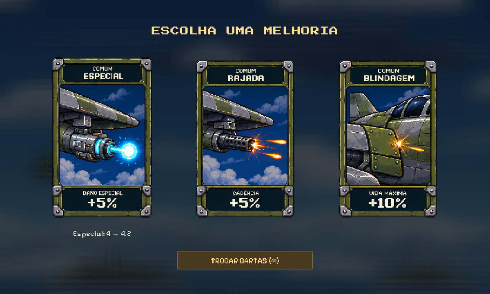
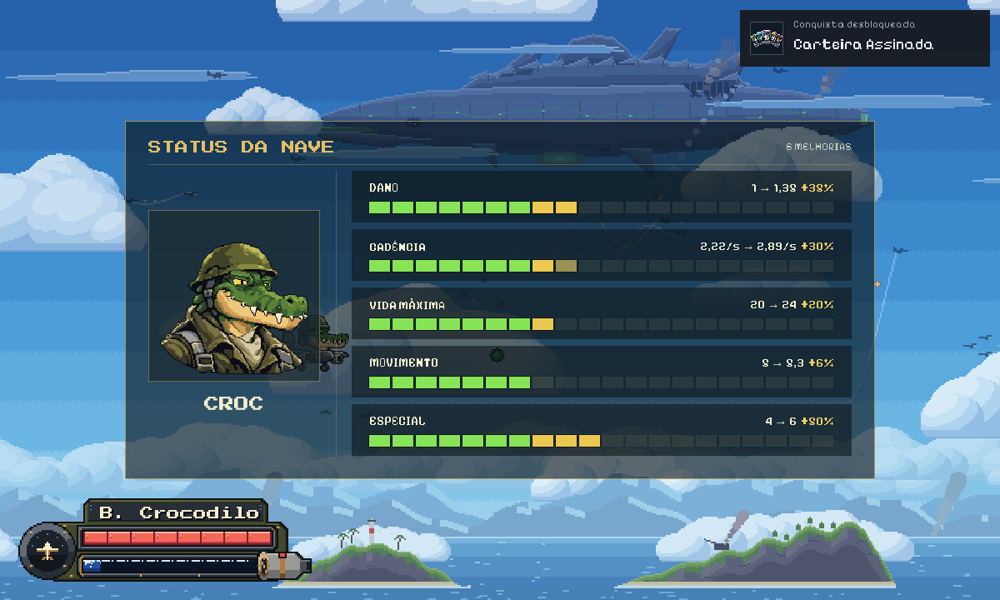
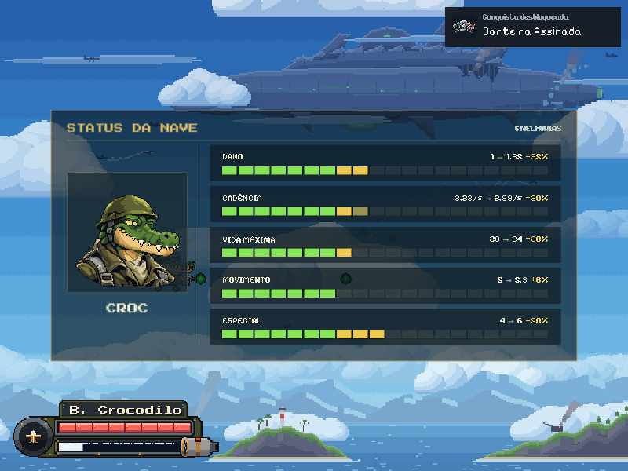

# Cartas limpas e status ao segurar Tab

Na escolha de cartas fica um único título, uma comparação de valor na carta em foco e o botão Trocar cartas com a quantidade restante. Foram ocultados subtítulo, linha decorativa, rodapé de controles, resumo de cinco atributos e a segunda linha de bônus total. Artes, animações, sons, atalhos 1/2/3/R e regras de escolha/reroll permanecem os mesmos.

O status aparece somente enquanto Tab estiver pressionado (Select/View no controle). Sem botão ou dica no HUD. O painel é de leitura: não pausa, não altera o áudio, não bloqueia cliques e não toma foco do EventSystem. Esconde ao soltar, pausar, morrer, entrar em uma escolha de cartas ou desativar o HUD. Não aparece no menu/base sem PlayerHUD de combate.

Composição inspirada na referência enviada pelo usuário: retrato original do Croc à esquerda; cinco linhas de atributos com barras segmentadas à direita. Fundo azul-marinho com alfa 0,18, sem desfoque ou camada de escurecimento em tela cheia. Valores iniciais e atuais e bônus acumulados vêm de PlayerRunUpgrades; a interface não altera nem grava os bônus. As barras usam escala visual compartilhada expansível para não impor um teto fictício às combinações de cartas. Verde indica a referência inicial; dourado, os ganhos.

RunUpgradeView é um prefab nativo em Assets/Resources/RunUpgrades, instanciado e vinculado pelo PlayerHUD. Atualiza números por evento Changed; não procura objetos por frame. CleanCardUpgradeTools.Install altera o prefab de cartas por PrefabUtility e configura o painel. A versão anterior que pausava e mostrava histórico foi substituída; os scripts antigos de preparação/QA ficaram apenas em Logs, fora de Assets.

CleanCardUpgradeValidation.Run verifica escolhas e rerolls reais, foco da comparação, três resoluções, desmontagem entre cenas e Tab durante uma primeira onda normal com movimento e tiros. A abertura de diálogo é pulada apenas no cenário de QA; não é um teste de balanceamento. As capturas demonstrativas incluem bônus aplicados pelo auxiliar para exercitar os cinco atributos. Saves de conquistas/campanha são isolados.

Capturas finais e validation.json: Docs/ArtPreviews/CleanCardsTab_v02. Log final: CleanCardsTab-v02-Verified.log. Build separado: Builds/Windows-CleanCards-Tab-v02; conferir Logs/CleanCardsTab-v02-Build.log. Revisão publicada no PR #26 em quatro commits separados, com autoria Picolii.

Validação final: 83 verificações / zero erros. O tempo avançou 0,435 s, a nave moveu 2,095 unidades e houve disparo real com Tab pressionado. Capturas conferidas em 800×600, 1200×720 e 1920×1080.

Resultado final v02: build Windows concluído (212.533.847 bytes reportados), inicialização de oito segundos sem erros/exceções, 2725 GUIDs únicos e todos os assets com metadados. Código alterado sem erros de whitespace. 83 verificações de Play Mode passaram. Esta revisão acrescenta quatro commits separados ao PR26; author e committer Picolii / bernardo.p2106@gmail.com.

## Fotos

Seleção limpa:

Status ao segurar Tab, durante o combate:

Adaptação em 800×600:

## Correções da revisão de código — 09/11/2026

- O status não abre durante diálogos nem depois de pular a cena com Tab ainda pressionado: é preciso soltar a tecla.
- Painel refeito com cabeçalho, moldura no retrato e cartões por atributo. Fundo geral com alfa 0,6 e cartões com alfa 0,62, translúcidos e legíveis sobre o combate.
- A comparação da carta usa os mesmos nomes e números do painel (`UpgradeText`).

Validação: 88 verificações de Play Mode, zero erros.
